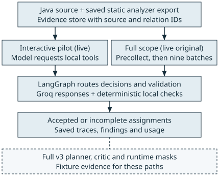
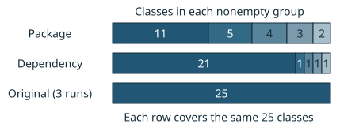

# TraceMicro: A Preliminary Case Study of Evidence-Linked LLM Decomposition on PetClinic

**Authors:** [Verified names and affiliations pending]

**Project code:** G3-06

## Abstract

Large language models can generate machine-readable recommendations for decomposing monolithic applications, but a valid output does not necessarily identify useful service boundaries. This paper presents TraceMicro, an evidence-linked workflow for assigning Java classes to candidate services, and examines its recorded behavior on a PetClinic development snapshot. The system combines source and static-dependency evidence, structured model responses, LangGraph orchestration, shared-class support, deterministic validation and bounded request accounting. We compare package grouping, a deterministic dependency baseline and three completed full-scope model executions over 25 eligible classes. The deterministic methods produce group sizes of 11/5/4/3/2 and 21/1/1/1/1, respectively. All three model executions satisfy coverage and citation-reference checks yet assign every class exclusively to one service. Together they consume 27 requests and 144,478 reported tokens. A separate three-class interactive pilot produces two overlapping groups, while two full-scope planning configurations fail before assignments begin. These observations demonstrate an inspectable execution pipeline and a repeatable single-group outcome. Architectural quality remains unmeasured. We distinguish software verification, operational feasibility and architectural assessment, and identify the independent references and controlled experiments needed to evaluate proposed extensions.

**Keywords:** microservice decomposition; language-model workflows; architectural evidence; LangGraph; failure analysis; reproducibility.

## 1. Introduction

Recommending service boundaries requires decisions about business responsibilities, data ownership and interactions between application components. A class inventory or dependency graph can inform these decisions, but neither representation alone defines the intended architecture. Model-assisted decomposition introduces another distinction: a recommendation can follow the requested output format while failing to separate meaningful responsibilities.

TraceMicro investigates an evidence-linked workflow in which model recommendations remain connected to identifiable source and relationship records. Its development begins from MicroAgent as the designated base method [1]. The present study does not reproduce the full MicroAgent pipeline or report a matched performance comparison. Instead, it examines an implemented prototype and its development record on one fixed source subset.

The central research question is: **What assignments does a bounded, evidence-linked workflow produce on the PetClinic snapshot, and what do its validation, repetition and failure records establish?** Three supporting questions concern completion of the declared class scope, grouping behavior across repeated executions, and the distinction between validation failures, provider rejections and transport failures.

The contribution is threefold. First, we describe an executable source-to-assignment workflow with explicit evidence identifiers, shared memberships and local checks. Second, we report a descriptive comparison of two deterministic baselines and three completed model runs on a common 25-class universe. Third, we document failures and measurement limitations that prevent operational success from being interpreted as architectural quality. These are contributions of this development case study; priority over other decomposition systems and general improvements in architecture quality are not established.

## 2. Background and relationship to the base method

MicroAgent uses context compression and analytical tools for domain identification, clustering and merging, common-class assignment and final refinement [1]. Section 3.2.4 revisits assigned and unassigned classes. TraceMicro uses a saved export from the official static analyzer. A matched evaluation of the full MicroAgent workflow remains open.

Mono2Micro uses runtime call relationships tied to business use cases [2]. Our input is static. Wang et al. compare decomposition tools on common applications using structural and business-use-case criteria [3]. Their study motivates comparison on the same class universe and assessment beyond graph structure. Liljas et al. study tool-assisted reconstruction of existing service architectures [4], a different task from recommending new boundaries for a monolith.

The interactive TraceMicro pilot allows a model to request source or dependency evidence before submitting assignments. This is related to the broader idea of interleaving decisions with external actions in ReAct [5]. TraceMicro does not claim to reproduce ReAct's benchmark results or require a stored reasoning trace. The full-scope variant further restricts model freedom by collecting evidence before inference and exposing a submission-only contract.

LangGraph connects model decisions, local tools and validation [6]. Studies of software-agent trajectories motivate logging actions, resource use and failure patterns [7]. RepairAgent also interleaves tool use and validation in a program repair setting [8]. Puma Pucho and Cafeo separate coordination and communication factors in a study of Python refactoring [9]. Their experimental design motivates isolating coordination choices in a future decomposition study. PetClinic is a Spring sample application [10]. We use a fixed Java-only subset.

## 3. Problem and system design

### 3.1 Assignment representation

Let C be the eligible class set and S the available candidate service labels. A recommendation maps each class c to a nonempty service set M(c) contained in S. A class with multiple memberships is explicitly marked shared. Candidate labels identify groups; their spelling does not establish business meaning.

An assignment contains the class identifier, service memberships, a shared flag and evidence identifiers. The local validator checks that each scoped class appears once, memberships use allowed distinct labels, sharing is internally consistent, and citations refer to available records for that same class. In the evaluated full-scope workflow, both source and dependency record types are required.

These checks establish a structural contract. They do not decide whether cited material semantically supports a service boundary or whether every technically reusable class should be shared. In particular, the contract permits all classes to have the same single membership.

### 3.2 Evidence and interactive execution

The evidence store exposes numbered source excerpts and saved static relationships. Each evidence item has an identifier, allowing a submitted row to point to the material supplied during execution. Source excerpts are bounded and partial coverage is marked explicitly. Dependency evidence records relationship types and endpoints but lacks complete resolution diagnostics and per-edge source locations.

In the three-class pilot, the model chooses inspections and receives results through local tools. State contains the scope, allowed labels, remaining budgets, collected evidence, candidate assignments, validation findings and termination reason. LangGraph routes execution among decision, source inspection, dependency inspection, validation and finish operations. A rejected candidate can receive findings and use a bounded correction allowance.

Figure 1 distinguishes the observed execution paths from optional paths with fixture evidence.

### 3.3 Full-scope batching

The original full-scope workflow precollects one source and one dependency record for each eligible class, giving 50 local evidence records. Classes are processed in sorted order through eight batches of three and a final singleton. Each batch permits a submission and one correction. Accepted assignments become context for later batches.

Five neutral service labels are available, without a requirement that all be used. The successful original contract permits only submission actions. A concrete submission example names the first candidate label. This setting differs from the smaller pilot, which uses two domain-suggestive labels and model-selected evidence inspections. The two workflows therefore cannot be compared as a controlled scale experiment.

### 3.4 Planning, criticism and measurement

A global-plan variant proposes service responsibilities before assigning classes. Its first version supplies a large evidence context. A compact version supplies class names, declaration anchors, summarized outgoing relationships and omission warnings. The planned assignment path receives the service responsibilities and drops the original concrete example. Bounded v3 requires brief responsibilities and one or two distinct evidence IDs per service, checked locally. Planning therefore changes the call count, evidence exposure and assignment context together.

An implemented advisory critic can record concerns and proposed changes, but does not apply them. Fixed and selective routing are available. Runtime masking and recovery components have synthetic fixture coverage. None of these components has a measured architectural-quality effect in the supplied record.

Request ledgers record transport attempts, pacing and pre-request deadlines. Attempted calls are counted even when no HTTP response arrives. Missing provider usage remains unknown and is not converted to zero. Historical ledgers are retained as evidence rather than automatically reused after machine restart.

## 4. Study design

### 4.1 Dataset and baselines

The development snapshot contains 30 Java files, of which five package-info files are excluded, leaving 25 eligible class identifiers. The eligible-content fingerprint is `c66415bfe029129bc8229a36216547dd41c3ba32d7aad5b8590dd00ac4622e29`. The exact upstream revision and download date are unknown. The source subset is not a verified runnable application.

The saved analyzer export contains 25 nodes, 59 directed typed dependency records and 42 distinct directed endpoint pairs. It also reports 181 static occurrences. These quantities are not runtime invocation counts. All expected filename/package identifiers are present, although analyzer limitation probes demonstrate that identifier coverage does not guarantee complete parsing or reference resolution.

The package baseline groups classes by declared Java package. The dependency baseline starts with singletons and merges the pair with greatest cross-link density on the simple undirected graph. Density divides the number of links between the groups by the product of their sizes. Lexical order breaks ties, including zero-link ties, until five groups remain. Its target count matches the observed package count. This is a project baseline rather than the full MicroAgent method.

### 4.2 Model conditions

The three completed full-scope runs use Groq's `openai/gpt-oss-20b`, recorded temperature zero, strict structured output and a requested output limit of 1,024 tokens per call. Deliberate 60-second spacing accounts for most elapsed time. An immutable served-model revision and a controlled random seed are not established.

The repeated series comprises one original success and two repetitions under the frozen method. Earlier failed versions are included in the development history but are not pooled with this series to estimate a frozen-method failure probability. Planning variants and the reduced-context probe are separate conditions.

### 4.3 Measures

We report accepted-class coverage, nonempty group sizes, shared memberships, validation findings, requests, reported token usage, recorded pacing and elapsed time. Repeatability is assessed through complete co-membership neighborhoods after ignoring service-label spelling, while retaining shared memberships. This is output agreement, not agreement with an independent reference.

For structural diagnostics, an edge crosses groups when its endpoint membership sets are disjoint. Only records with both endpoints assigned enter the crossing denominator. We report typed records and distinct ordered pairs separately. The complete 25-class results have denominators of 59 and 42. A one-group assignment necessarily has zero crossing edges. No quality conclusion is derived from that property.

No completed independent reference or frozen solo reference is available. Consequently, architectural precision, recall, F1 and assignment-error reduction are not reported. Software tests and simulated transport runs are recorded separately from live model executions.

## 5. Results

### 5.1 Baseline structure and complete live runs

| Method | Accepted classes | Nonempty group sizes | Shared classes | Crossing typed records | Crossing directed pairs |
|---|---:|---|---:|---:|---:|
| Package baseline | 25/25 | 11, 5, 4, 3, 2 | 0 | 14/59 | 14/42 |
| Dependency baseline, k=5 | 25/25 | 21, 1, 1, 1, 1 | 0 | 0/59 | 0/42 |
| Original model run | 25/25 | 25 | 0 | 0/59 | 0/42 |
| Repetition 1 | 25/25 | 25 | 0 | 0/59 | 0/42 |
| Repetition 2 | 25/25 | 25 | 0 | 0/59 | 0/42 |

The package grouping follows owner, vet, system, model and application-root packages. The dependency baseline combines all owner, vet, model and application-root classes into its 21-class group, leaving four system classes as singletons. The stored merge history contains two zero-link merges. Table 1 reports coverage and crossing counts. Figure 2 compares nonempty group sizes.

Each completed model run assigns all classes exclusively to `candidate_1`; the other available labels remain empty. All 27 assignment batches across the three runs pass on their first submissions. Every pair of completed outputs agrees on all 25 class membership neighborhoods. This establishes repeatability on this input and configuration, without demonstrating useful service separation.

### 5.2 Resource measurements

| Run | Requests | Input tokens | Output tokens | Total tokens | Pacing seconds | Elapsed seconds |
|---|---:|---:|---:|---:|---:|---:|
| Original | 9 | 44,014 | 3,823 | 47,837 | 479.799 | 491.156 |
| Repetition 1 | 9 | 44,014 | 4,063 | 48,077 | 479.859 | 492.797 |
| Repetition 2 | 9 | 44,014 | 4,550 | 48,564 | 539.109 | 550.485 |

Table 2 summarizes the three runs. All 27 calls reported token usage, totaling 144,478 tokens. Mean reported tokens per run are 48,159.3 with sample standard deviation 370.4. Mean elapsed time is 511.5 seconds with sample standard deviation 33.8. These values describe three runs of one development application. The last repetition inherits a cooldown from the preceding run, contributing an additional wait. Elapsed time should therefore not be interpreted as model inference latency. Monetary charges were not recorded.

### 5.3 Smaller interactive pilot

The three-class LangGraph pilot assigns Owner to `owners_candidate`, Vet to `vets_candidate`, and BaseEntity to both. It makes seven model requests and six local inspections, reports 24,401 tokens, and ends with no validation findings. It takes 368.423 seconds, including 359.876 seconds of recorded pacing. Each group contains two memberships, giving four memberships across three unique classes. Each assignment cites source and dependency evidence.

This result demonstrates successful interaction and shared-class representation under a limited scope. It does not establish that BaseEntity should be shared or explain the full-scope collapse. The pilot and original full-scope method differ in labels, evidence acquisition and context.

### 5.4 Planning and development failures

Table 3 retains the distinct configurations and stages.

| Attempt | Recorded failure or result | Requests | Accepted classes | Reported usage |
|---|---|---:|---:|---|
| Earlier full-scope live_1 | Invalid service labels; correction exhausted | 2 | 0/25 | 9,560 tokens |
| Earlier full-scope live_2 | Batch 2 HTTP 400 / json_validate_failed | 2 | 3/25 | 4,831 known; failed-call usage unknown |
| Earlier full-scope live_3 | Batch 2 HTTP 400 / json_validate_failed | 2 | 3/25 | 4,831 known; failed-call usage unknown |
| Separate network attempt | No HTTP response | 1 | 0/25 | Unknown |
| Global planner v1 | HTTP 413 / rate_limit_exceeded; 139,972 bytes | 1 | 0/25 | Unknown |
| Compact planner v2 | HTTP 400 / json_validate_failed; 9,464 bytes | 1 | 0/25 | Unknown |
| Reduced planning probe | Plan parsing and local checks passed | 1 | No assignment stage | 1,358 tokens |

The two planning configurations fail before assignment, after 0.375 seconds for v1 and 1.828 seconds for v2. Both record zero pacing. Compact v2 returns an empty rejected-generation field, preventing inspection of the offending content. The reduced probe retains the planning instructions, schema and generation settings but limits context to one class and two evidence records, reducing the request to 3,242 bytes. The provider reports 710 input and 648 output tokens over 1.375 seconds, with zero pacing. Its success establishes small-context feasibility only. All three proposed responsibilities cite the same application declaration, so passing reference checks does not independently validate the responsibilities.

The saved v3 path completes under injected transport with artificial assignments. The inspected results contain no completed live full-scope v3 run.

## 6. Discussion

### 6.1 What validation established

The complete model outputs satisfy the implemented contract because every class is present, labels are allowed, sharing is consistent and citations exist for the corresponding class. None of those conditions requires multiple services or assesses business responsibility. A single-service output therefore passes by design.

For example, the recorded Owner assignment cites an explicitly partial source excerpt, E11, and static relationships, E12. The validator confirms both required evidence types and returns no findings. It does not assess whether the cited material supports grouping Owner with every vet and infrastructure class. This is an observable limitation of the local checks rather than evidence that citations themselves are useless.

### 6.2 Candidate explanations and causal limits

The original prompts contain a concrete `candidate_1` example, neutral labels without established responsibilities and previously accepted assignments. These features could reinforce early choices. The evidence does not isolate their effects. The global-plan variant changes several factors simultaneously, so even a future nontrivial grouping would initially support the combined variant rather than a particular causal explanation.

Forcing all five groups to be nonempty would prevent the observed single-group output but would also change the task. Such a constraint must be an explicit experimental condition, not a retrospective repair presented as improved understanding.

### 6.3 Status of the proposed research gaps

| Proposed gap | Current implemented component | Outcome evidence still missing |
|---|---|---|
| G1: Reliability when architectural evidence is incomplete | Static omission flags; synthetic scenario masking and recovery | Real runtime scenarios and matched quality under evidence loss |
| G2: Independent verification of decomposition recommendations | Structural checks; fixture-tested advisory critic | Independently assessed errors and a defined correction procedure |
| G3: Quality–cost trade-offs in agent coordination | Request accounting; fixed/selective routing | Repeated matched live comparisons with quality assessment |

Table 4 summarizes the state of the approved gaps. The advisory critic does not change assignments, so it cannot currently demonstrate reduced assignment errors. Its selective rule invokes criticism for findings or fewer than two nonempty groups. Applied offline to the three original outputs, both fixed and selective conditions select criticism. No call savings are established on those inputs.

## 7. Threats to validity

**Construct validity.** Coverage, valid citations, agreement and static crossing ratios are incomplete measures of architectural quality. The single-group output exposes their limitations. Shared memberships also require overlapping-group evaluation rather than ordinary partition comparison alone.

**Internal validity.** Prompt examples, batching order, prior assignments, evidence truncation and provider behavior are confounded. Temperature zero does not establish deterministic service behavior across future model revisions. Provider failures with empty diagnostics do not identify invalid schema features, truncation or token exhaustion.

**Data validity.** The exact upstream revision is unknown. Six source excerpts are partial: Owner, OwnerController, Pet, PetController, VisitController and VetController. The saved graph can omit dependencies and lacks complete resolution diagnostics. The subset supplies no measured runtime behavior or independently verified database evidence.

**External validity.** Results concern one small development snapshot. Three executions are repeated observations on that input, not three independent application benchmarks. JPetStore and AcmeAir remain held out, with source alignment and reference provenance unresolved. No deployment or behavioral equivalence of extracted services was measured.

**Assessment and reproducibility.** Human review sheets remain blank. A future author-reviewed reference must disclose exposure to outputs and cannot be presented as independent adjudication. Saved logs record 142 passing full-suite tests and 17 passing focused tests at a later checkpoint. These historical checks concern software behavior. A clean release checkout and remote checkpoint remain unverified.

## 8. Reproducibility and next evaluation

The evidence package includes licensed source, the saved dependency graph, settings, accepted and incomplete outputs, and decision traces. The two baselines can be recomputed offline. Live measurements are recoverable from the recorded attempts without making new provider calls. Clean-install reproduction and public release remain pending.

The nearest feasible assessment is a frozen author-reviewed development reference with source-based rationales and explicit uncertainty. Scores against that reference would measure agreement with the author, with exposure bias disclosed. A stronger study requires independent annotation and adjudication, pinned runnable applications, matched MicroAgent executions, common evidence and service-count policies, component ablations and repeated quality–cost measurements. Runtime robustness needs actual scenario traces; synthetic events cannot establish that result.

One bounded live v3 run could establish full-scope planning feasibility, but would not by itself demonstrate architectural improvement. A terminal failure should remain part of the record rather than trigger unrestricted retries. Changed configurations should start separately identified series.

## 9. Conclusion

TraceMicro provides an inspectable implementation for connecting Java evidence, model-generated service assignments and deterministic checks. On the recorded PetClinic snapshot, three completed original full-scope executions cover all 25 classes and consistently produce one service. A smaller interactive pilot represents shared membership successfully, while full planning attempts expose separate operational failures. The evidence supports workflow feasibility, repeatability and a documented limitation of structural validation. Architectural accuracy, superiority over MicroAgent and improvements on the three proposed gaps remain unmeasured. The next priority is a defensible reference-based assessment, alongside a bounded feasibility test of the planning variant where resources permit.

## References

[1] Su, Zishan; Huang, Junjie; Shan, Shiwen; Chen, Xingyan; Zeng, Hui; Su, Yuxin; Wang, Yanlin; Lyu, Michael R.. *MicroAgent: Context-Augmented Multi-Agent Framework for Automatic Microservice Decomposition*. Proceedings of the 41st IEEE/ACM International Conference on Automated Software Engineering. 2026. https://doi.org/10.1145/3832783.3834441

[2] Kalia, Anup; Xiao, Jin; Krishna, Rahul; Sinha, Saurabh; Vukovic, Maja; Banerjee, Debasish. *Mono2Micro: A Practical and Effective Tool for Decomposing Monolithic Java Applications to Microservices*. ACM Joint European Software Engineering Conference and Symposium on the Foundations of Software Engineering. 2021. https://doi.org/10.1145/3468264.3473915

[3] Wang, Yingying; Bornais, Sarah; Rubin, Julia. *Microservice Decomposition Techniques: An Independent Tool Comparison*. Proceedings of the 39th IEEE/ACM International Conference on Automated Software Engineering. 2024. https://doi.org/10.1145/3691620.3695504

[4] Liljas, Venla; Esposito, Matteo; Lenarduzzi, Valentina; Taibi, Davide. *Can Agents Reconstruct Microservice Architecture?*. 20th International Symposium on Empirical Software Engineering and Measurement. 2026. https://doi.org/10.4230/LIPIcs.ESEM.2026.62

[5] Yao, Shunyu; Zhao, Jeffrey; Yu, Dian; Du, Nan; Shafran, Izhak; Narasimhan, Karthik; Cao, Yuan. *ReAct: Synergizing Reasoning and Acting in Language Models*. International Conference on Learning Representations. 2023. https://arxiv.org/abs/2210.03629

[6] LangChain. *LangGraph Overview*. Official documentation. https://docs.langchain.com/oss/python/langgraph/overview

[7] Bouzenia, Islem; Pradel, Michael. *Understanding Software Engineering Agents: A Study of Thought-Action-Result Trajectories*. IEEE/ACM International Conference on Automated Software Engineering. 2025. https://software-lab.org/publications/ase2025_trajectories.pdf

[8] Bouzenia, Islem; Devanbu, Premkumar; Pradel, Michael. *RepairAgent: An Autonomous, LLM-Based Agent for Program Repair*. IEEE/ACM International Conference on Software Engineering. 2025. https://doi.org/10.1109/ICSE55347.2025.00157

[9] Puma Pucho, Alexander; Cafeo, Bruno B. P.. *A Factorial Comparison of LLM-Based Multi-Agent Architectures for Automated Python Refactoring*. 20th International Symposium on Empirical Software Engineering and Measurement. 2026. https://doi.org/10.4230/LIPIcs.ESEM.2026.37

[10] Spring Projects. *Spring PetClinic Sample Application*. Official source repository. https://github.com/spring-projects/spring-petclinic
