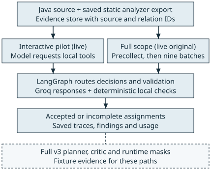
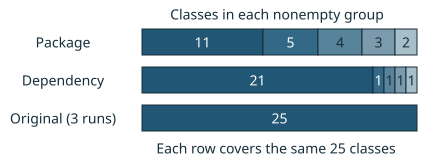

# TraceMicro: A Preliminary Case Study of Evidence-Linked LLM Decomposition on PetClinic
Project code G3-06

**Muhammad Umer Bin Usman**  
Roll number 23i-0754  
Department of Computer Science  
FAST National University of Computer and Emerging Sciences  
Islamabad, Pakistan  
<i230754@isb.nu.edu.pk>

**Hafiz Ahmad**  
Roll number 23i-0714  
Department of Computer Science  
FAST National University of Computer and Emerging Sciences  
Islamabad, Pakistan  
<i230714@isb.nu.edu.pk>

**Ibraheem Aziz**  
Roll number 23i-0596  
Department of Computer Science  
FAST National University of Computer and Emerging Sciences  
Islamabad, Pakistan  
<i230596@isb.nu.edu.pk>

Under the instruction of Mr. Muhammad Owais Idrees  
Department of Computer Science  
FAST National University of Computer and Emerging Sciences  
Islamabad, Pakistan

## Abstract

Large language models can generate machine-readable recommendations for decomposing monolithic applications, but a valid output does not necessarily identify useful service boundaries. This paper presents TraceMicro, an evidence-linked workflow for assigning Java classes to candidate services, and examines its recorded behavior on a PetClinic development snapshot. The system combines source and static-dependency evidence, structured model responses, LangGraph orchestration, shared-class support, deterministic validation and bounded request accounting. We compare package grouping, a deterministic dependency baseline and three completed full-scope model executions over 25 eligible classes. The deterministic methods produce group sizes of 11/5/4/3/2 and 21/1/1/1/1, respectively. All three model executions satisfy coverage and citation-reference checks yet assign every class exclusively to one service. Together they consume 27 requests and 144,478 reported tokens. A separate three-class interactive pilot produces two overlapping groups, while three full-scope planning attempts stop before assignments begin. These observations demonstrate an inspectable execution pipeline and a repeatable single-group outcome. Compact v3 reaches its 1,024-token planning allowance. A 2,048-token variant completes planning and fails on the first assignment request. Against an AI-assisted author development reference prepared after model exposure, domain-pair F1 is 1.000 for package grouping and 0.703 for the dependency baseline and each original run. All five miss all three annotated shared classes. Independent architectural accuracy remains unmeasured.

**Keywords:** microservice decomposition; language-model workflows; architectural evidence; LangGraph; failure analysis; reproducibility.

## 1. Introduction

Recommending service boundaries requires decisions about business responsibilities, data ownership and interactions between application components. A class inventory or dependency graph can inform these decisions, but neither representation alone defines the intended architecture. Model-assisted decomposition introduces another distinction: a recommendation can follow the requested output format while failing to separate meaningful responsibilities.

TraceMicro investigates an evidence-linked workflow in which model recommendations remain connected to identifiable source and relationship records. Its development begins from MicroAgent as the designated base method [1]. The present study does not reproduce the full MicroAgent pipeline or report a matched performance comparison. Instead, it examines an implemented prototype and its development record on one fixed source subset.

The central research question is: **What assignments does a bounded, evidence-linked workflow produce on the PetClinic snapshot, and what do its validation, repetition and failure records establish?** Three supporting questions concern completion of the declared class scope, grouping behavior across repeated executions, and the distinction between validation failures, provider rejections and transport failures.

The contribution is threefold. First, we describe an executable source-to-assignment workflow with explicit evidence identifiers, shared memberships and local checks. Second, we report a descriptive comparison of two deterministic baselines and three completed model runs on a common 25-class universe. Third, we document failures and measurement limitations that prevent operational success from being interpreted as architectural quality. These are contributions of this development case study; priority over other decomposition systems and general improvements in architecture quality are not established.

## 2. Related work

### 2.1 Evidence for identifying service boundaries

Classifications of monolith refactoring and recent mapping work distinguish approaches by the artifacts they consume and the evidence they use to evaluate a proposed boundary [2] [3]. Service Cutter formalizes coupling criteria [4]. The Feature Table approach represents functional features and supplies rules for mapping them to candidate services [5]. Oumoussa and Saidi cluster semantically related business-process activities [6]. In each case, the representation supplies information beyond package names. Our package baseline deliberately omits those signals so it can serve as an inexpensive, reproducible reference for visible organization.

Static analysis can go beyond unweighted class links. MicroMiner combines static relationships with source semantics and guides identification using service types [7]. Mathai et al. encode distinct artifact and relationship types in a heterogeneous graph before constrained clustering [8]. Our dependency baseline discards direction, type and frequency for the clustering step, while keeping typed records for the structural diagnostics. This makes it possible to trace a proposal back to the same static input without giving the baseline semantic evidence that it never used.

Runtime evidence addresses a different question: which classes participate together in observed scenarios. Mono2Micro groups classes using runtime call relationships and business use cases [9]. Krause et al. combine static analysis, bounded contexts and dynamic visualization [10]. MonoBreaker uses static structure and dynamic behavior in a boundary-identification case study [11]. These studies motivate a controlled runtime-evidence condition for G1. Their results do not determine what the TraceMicro workflow would do when scenarios are missing. Industrial migration studies also treat a service cut as part of an iterative process involving technical and business knowledge [12]. The present study ends at class-assignment recommendations.

### 2.2 Context, tools and validation

MicroAgent is our base method [1]. It uses application- and class-level context and specialized tools for domain identification, clustering and merging, common-class assignment and final refinement. Its Review Agent revisits assigned and unassigned classes (§3.2.4). Our use of its saved analyzer output preserves the origin of the static evidence. The local record does not contain a run of the complete MicroAgent model pipeline on this class universe. Wang et al.’s independent tool comparison illustrates why aligned applications, metrics and business criteria matter in a direct comparison [13]. Liljas et al. study recovery of an existing microservice architecture from repositories [14]. TraceMicro instead proposes a division for a monolith whose target assignment is unavailable here.

ReAct interleaves decisions and actions [15]. SWE-agent examines how a task-specific interface changes repository interaction [16], and OpenHands provides a general platform for sandboxed tool use and evaluation [17]. TraceMicro exposes two read-only evidence tools in its small interactive pilot and a submit-only contract in its batched original workflow. LangGraph routes the resulting decisions and validations [18]. The batch-versus-pilot comparison therefore involves a change in interface and evidence access as well as class count.

SWE-bench evaluates issue resolution with tests [19]. ExecutionAgent addresses the upstream challenge of running those kinds of tests across varied environments [20]. RepairAgent distinguishes plausible repairs from correctly assessed repairs [21]. RefAgent combines planning, execution, testing and refinement for Java refactoring [22], while CodeCureAgent checks builds, warning status and tests and also assesses a sample of fixes manually [23]. These studies motivate separating operational checks from task correctness in G2. In our setting, a valid citation establishes that a reference resolves to supplied material. Evaluating whether that material justifies a proposed boundary requires an assessment suited to decomposition.

### 2.3 Coordination and resource measurement

Bouzenia and Pradel analyze recorded agent trajectories to examine action sequences, failures and token use [24]. SWE-Search adds trajectory exploration and selection [25]. Puma Pucho and Cafeo separate communication structure and coordination policy in a controlled refactoring study [26]. Together these studies motivate logging actions and resource use and holding capabilities fixed when comparing coordination strategies. For G3, the TraceMicro critic-routing rule can be replayed offline, while claims about quality-preserving savings require matched live costs and independently assessed assignments.

## 3. Problem and system design

### 3.1 Assignment representation

Let C be the eligible class set and S the available candidate service labels. A recommendation maps each class c to a nonempty service set M(c) contained in S. A class with multiple memberships is explicitly marked shared. Candidate labels identify groups; their spelling does not establish business meaning.

A submission is an object with one assignment list. Each row has four fields: class identifier, a nonempty list of services, a Boolean shared flag and an evidence-ID list. Validation first checks the submission and row shapes. It then identifies missing, unknown and duplicate class records against the current scope, rejects unknown or repeated labels, and checks that the flag is true exactly when a row has multiple services. It checks each cited ID against the evidence already available for that same class. Both a source record and a dependency record must be cited. A structurally valid row can still leave the class's business responsibility unresolved.

### 3.2 Evidence and interactive execution

The evidence store exposes numbered source excerpts and saved static relationships. Each evidence item has an identifier, allowing a submitted row to point to the material supplied during execution. Source excerpts are bounded and partial coverage is marked explicitly. Dependency evidence records relationship types and endpoints but lacks complete resolution diagnostics and per-edge source locations.

In the three-class pilot, the model chooses inspections and receives results through local tools. State contains the scope, allowed labels, remaining budgets, collected evidence, candidate assignments, validation findings and termination reason. LangGraph routes execution among decision, source inspection, dependency inspection, validation and finish operations. A rejected candidate can receive findings and use a bounded correction allowance.

Figure 1 distinguishes the observed execution paths from optional paths with fixture evidence.

### 3.3 Full-scope batching

The original full-scope workflow precollects one source and one dependency record for each eligible class, giving 50 local evidence records. Classes are processed in sorted order through eight batches of three and a final singleton. Each batch permits a submission and one correction. Accepted assignments become context for later batches.

Five neutral service labels are available, without a requirement that all be used. The successful original contract permits only submission actions. A concrete submission example names the first candidate label. This setting differs from the smaller pilot, which uses two domain-suggestive labels and model-selected evidence inspections. The two workflows therefore cannot be compared as a controlled scale experiment.

### 3.4 Original submit-only workflow

The following procedure summarizes the recorded full-scope path. Each accepted batch supplies context for later batches, whose validators still operate on their own scopes.

1. Sort the eligible fully qualified class identifiers. Precollect a line-numbered source excerpt and a static dependency record per class, and assign stable evidence IDs before making any model calls.
2. For each batch, send the scoped records, allowed service labels and earlier accepted rows. Request the structured submit action under the available request and pacing budget.
3. Validate the returned candidate. Accept the whole batch if it passes. For local validation findings, submit the findings as feedback and allow one correction when the budget permits.
4. On a terminal batch failure, save the failure and previously accepted rows and stop. When all batches pass, validate the combined output on the full class universe. Persist the disposition, findings, assignments, usage and timing.

### 3.5 Planning, criticism and measurement

A global-plan variant proposes service responsibilities before assigning classes. Its first version supplies a large evidence context. A compact version supplies class names, declaration anchors, summarized outgoing relationships and omission warnings. The planned assignment path receives the service responsibilities and drops the original concrete example. Bounded v3 requires brief responsibilities and one or two distinct evidence IDs per service, checked locally. Planning therefore changes the call count, evidence exposure and assignment context together.

An implemented advisory critic can record concerns and proposed changes, but does not apply them. Fixed and selective routing are available. Runtime masking and recovery components have synthetic fixture coverage. None of these components has a measured architectural-quality effect in the supplied record.

Request ledgers record transport attempts, pacing and pre-request deadlines. Attempted calls are counted even when no HTTP response arrives. Missing provider usage remains unknown and is not converted to zero. Historical ledgers are retained as evidence rather than automatically reused after machine restart.

## 4. Study design

### 4.1 Dataset and baselines

PetClinic is a Spring sample application [27]. The development snapshot contains 30 Java files, of which five package-info files are excluded, leaving 25 eligible class identifiers. The eligible-content fingerprint is `c66415bfe029129bc8229a36216547dd41c3ba32d7aad5b8590dd00ac4622e29`. The exact upstream revision and download date are unknown. The source subset is not a verified runnable application.

The saved analyzer export contains 25 nodes, 59 directed typed dependency records and 42 distinct directed endpoint pairs. It also reports 181 static occurrences. These quantities are not runtime invocation counts. All expected filename/package identifiers are present, although analyzer limitation probes demonstrate that identifier coverage does not guarantee complete parsing or reference resolution.

The package baseline extracts declarations from the eligible files after masking comments and literal text and groups files by exact package. A file without a declaration remains unassigned. The graph baseline checks that the package-plus-filename identifiers align with the analyzer nodes. It excludes exported inverse relationships and retains a directed triple of source, target and type with a positive occurrence count for each direct record. For clustering, it collapses the triples to unordered endpoint pairs and gives each pair unit weight.

Starting from one group per node, the graph baseline evaluates every pair of groups. Its score is the number of unordered links with one endpoint in each group divided by the product of their sizes. It selects the maximum using exact rational comparisons and breaks ties lexicographically on the sorted member tuples. This rule still merges a pair when all remaining scores are zero. It stops at five groups, the observed package count. For reporting crossings, it returns to the typed directed triples and separately deduplicates ordered endpoint pairs. Thus graph statistics do not depend on the loss of types in the clustering projection.

### 4.2 Model conditions

The three completed full-scope runs use Groq's `openai/gpt-oss-20b`, recorded temperature zero, strict structured output and a requested output limit of 1,024 tokens per call. Deliberate 60-second spacing accounts for most elapsed time. An immutable served-model revision and a controlled random seed are not established.

The repeated series comprises one original success and two repetitions under the frozen assignment method. The first run had an 18-attempt session cap and up to 1,020 seconds of requested pacing. The repetitions shared a 24-attempt ledger with a 1,380-second requested-pacing cap. All three runs used the same two-attempt batch limit, 15-second socket timeout and 64,000-byte request cap. The larger shared ledger affects accounting and the second repetition can inherit cooldown across runs. Earlier failed versions are included in the development history but are not pooled with this series to estimate a frozen-method failure probability. Planning variants and the reduced-context probe are separate conditions.

### 4.3 Measures

We report accepted-class coverage, nonempty group sizes, shared memberships, validation findings, requests, reported token usage, recorded pacing and elapsed time. Repeatability is assessed through complete co-membership neighborhoods after ignoring service-label spelling, while retaining shared memberships. This is output agreement, not agreement with an independent reference.

For structural diagnostics, an edge crosses groups when its endpoint membership sets are disjoint. Only records with both endpoints assigned enter the crossing denominator. We report typed records and distinct ordered pairs separately. The complete 25-class results have denominators of 59 and 42. A one-group assignment necessarily has zero crossing edges. No quality conclusion is derived from that property.

The author approved a development reference with ChatGPT assistance after seeing model outputs. The 25 class decisions were frozen before scoring. Domain-pair precision, recall and F1 compare co-memberships on the reference domain classes. Shared-class identification and shared-to-domain anchor associations are assessed separately, with service names ignored. An undefined precision is left blank when a method predicts no positive instances. Only complete outputs enter agreement scoring. Failed experiments remain in the reliability comparison. Independent architectural accuracy and assignment-error reduction remain unmeasured.

## 5. Results

### 5.1 Baseline structure and complete live runs

| Method | Accepted | Group sizes | Shared | Typed crossings | Pair crossings |
|---|---:|---|---:|---:|---:|
| Package baseline | 25/25 | 11, 5, 4, 3, 2 | 0 | 14/59 | 14/42 |
| Dependency baseline, k=5 | 25/25 | 21, 1, 1, 1, 1 | 0 | 0/59 | 0/42 |
| Original model run | 25/25 | 25 | 0 | 0/59 | 0/42 |
| Repetition 1 | 25/25 | 25 | 0 | 0/59 | 0/42 |
| Repetition 2 | 25/25 | 25 | 0 | 0/59 | 0/42 |

The package grouping follows owner, vet, system, model and application-root packages. The dependency baseline combines all owner, vet, model and application-root classes into its 21-class group, leaving four system classes as singletons. The stored merge history contains two zero-link merges. Table 1 reports coverage and crossing counts. Figure 2 compares nonempty group sizes.

Each completed model run assigns all classes exclusively to `candidate_1`; the other available labels remain empty. All 27 assignment batches across the three runs pass on their first submissions. Every pair of completed outputs agrees on all 25 class membership neighborhoods. This establishes repeatability on this input and configuration, without demonstrating useful service separation.

### 5.2 Resource measurements

| Run | Calls | Input tokens | Output tokens | Total tokens | Pace (s) | Elapsed (s) |
|---|---:|---:|---:|---:|---:|---:|
| Original | 9 | 44,014 | 3,823 | 47,837 | 479.799 | 491.156 |
| Repetition 1 | 9 | 44,014 | 4,063 | 48,077 | 479.859 | 492.797 |
| Repetition 2 | 9 | 44,014 | 4,550 | 48,564 | 539.109 | 550.485 |

Table 2 summarizes the three runs. All 27 calls reported token usage, totaling 144,478 tokens. Mean reported tokens per run are 48,159.3 with sample standard deviation 370.4. Mean elapsed time is 511.5 seconds with sample standard deviation 33.8. These values describe three runs of one development application. The last repetition inherits a cooldown from the preceding run, contributing an additional wait. Elapsed time should therefore not be interpreted as model inference latency. Monetary charges were not recorded.

### 5.3 Smaller interactive pilot

The three-class LangGraph pilot assigns Owner to `owners_candidate`, Vet to `vets_candidate`, and BaseEntity to both. It makes seven model requests and six local inspections, reports 24,401 tokens, and ends with no validation findings. It takes 368.423 seconds, including 359.876 seconds of recorded pacing. Each group contains two memberships, giving four memberships across three unique classes. Each assignment cites source and dependency evidence.

This result demonstrates successful interaction and shared-class representation under a limited scope. It does not establish that BaseEntity should be shared or explain the full-scope collapse. The pilot and original full-scope method differ in labels, evidence acquisition and context.

### 5.4 Planning and development failures

Table 3 retains the distinct configurations and stages.

| Attempt | Failure or outcome | Calls | Accepted | Reported tokens |
|---|---|---:|---:|---|
| Earlier full-scope live_1 | Invalid service labels; correction exhausted | 2 | 0/25 | 9,560 tokens |
| Earlier full-scope live_2 | Batch 2 HTTP 400 / `json_validate_failed` | 2 | 3/25 | 4,831 known; failed-call usage unknown |
| Earlier full-scope live_3 | Batch 2 HTTP 400 / `json_validate_failed` | 2 | 3/25 | 4,831 known; failed-call usage unknown |
| Separate network attempt | No HTTP response | 1 | 0/25 | Unknown |
| Global planner v1 | HTTP 413 / `rate_limit_exceeded`; 139,972 bytes | 1 | 0/25 | Unknown |
| Compact planner v2 | HTTP 400 / `json_validate_failed`; 9,464 bytes | 1 | 0/25 | Unknown |
| Reduced planning probe | Plan parsing and local checks passed | 1 | No assignment stage | 1,358 tokens |
| Compact planner v3 | Output limit reached; finish reason `length` | 1 | 0/25 | 3,464 tokens |
| Compact planner cap2048 | Plan accepted; batch 1 HTTP 400 / `json_validate_failed` | 2 | 0/25 | 3,505 known; failed-call usage unknown |

The v1 and v2 planning configurations stop after 0.375 and 1.828 seconds, respectively, with zero pacing. Compact v2 returns an empty rejected-generation field, preventing inspection of the offending content. The reduced probe retains the planning instructions, schema and generation settings but limits context to one class and two evidence records, reducing the request to 3,242 bytes. The provider reports 710 input and 648 output tokens over 1.375 seconds, with zero pacing. Its success establishes small-context feasibility only. All three proposed responsibilities cite the same application declaration, so passing reference checks does not independently validate the responsibilities.

The saved v3 path completes under injected transport with artificial assignments. The live compact v3 call reports 2,440 prompt and 1,024 completion tokens in 2.016 seconds, with zero pacing. Its finish reason is `length`. The client stops before parsing an action or applying local plan checks.

The 2,048-token planning condition returns five proposed responsibilities and passes local plan checks. Its planning call reports 2,440 prompt and 1,065 completion tokens. Batch 1 is rejected with HTTP 400 and an empty rejected-generation diagnostic. No finish reason or usage is available for the batch. No assignment reaches local validation. The run takes 63.547 seconds including 59.438 seconds of pacing. The infrastructure responsibility cites the Pet and PetController declaration anchors, which provide no evidence of configuration, caching or error handling.

### 5.5 Agreement with the author development reference

The approved reference marks 16 domain classes across owner and veterinary services, three shared classes (BaseEntity, NamedEntity and Person), and six infrastructure classes. All 25 classes are included with no uncertain or excluded decisions. Table 4 reports agreement with the author reference.

| Method | Pair precision | Pair recall | Pair F1 | Shared-class F1 | Shared-anchor F1 |
|---|---:|---:|---:|---:|---:|
| Package baseline | 1.000 | 1.000 | 1.000 | 0.000 | 0.000 |
| Dependency baseline | 0.542 | 1.000 | 0.703 | 0.000 | 0.000 |
| Original run | 0.542 | 1.000 | 0.703 | 0.000 | 0.000 |
| Repetition 1 | 0.542 | 1.000 | 0.703 | 0.000 | 0.000 |
| Repetition 2 | 0.542 | 1.000 | 0.703 | 0.000 | 0.000 |

The package baseline matches all 65 positive domain pairs with no false positives. The dependency baseline and each original run recover the same 65 positives and add 55 cross-service pairs, yielding 0.542 precision and 1.000 recall. All five methods cover 25/25 classes. They identify 0 of 3 shared classes and 0 of 48 shared-to-domain associations. Shared-class and shared-anchor precision are undefined because none were predicted. Infrastructure decisions enter the coverage calculation and are outside domain-pair scoring. The reliability export retains eight failed and three completed full-scope attempts across distinct configurations, six failed and three completed limited-scope runs, and the separate reduced planning probe.

## 6. Discussion

### 6.1 What validation established

The complete model outputs satisfy the implemented contract because every class is present, labels are allowed, sharing is consistent and citations exist for the corresponding class. None of those conditions requires multiple services or assesses business responsibility. A single-service output therefore passes by design.

**Owner walkthrough.** In batch 2 of the first completed run, the batch scope was NamedEntity, Person and Owner. The context included three accepted batch-1 rows using candidate_1. Owner's source record E11 contained lines 1–80 of 188 and marked the excerpt partial. It included the entity annotation at line 48 and the class declaration extending Person at line 50. The dependency record E12 identified Owner's static relationships, including the outgoing inheritance link to Person and incoming creation from OwnerController. E12 identifies an analyzer record rather than a source-line location.

The response submitted Owner with services set to candidate_1 alone, shared set to false and evidence set to E11 and E12. Local validation found that Owner was in the batch scope, its label was allowed, the shared flag matched its single membership and both cited IDs were same-class records of the required types. The trace records an empty findings list for the batch, so the row was accepted on the first submission and carried forward with the other batch-2 rows. The trace records the evidence presented and the output chosen. It does not record which input caused the model to choose candidate_1.

### 6.2 Candidate explanations and causal limits

The original prompts contain a concrete `candidate_1` example, neutral labels without established responsibilities and previously accepted assignments. These features could reinforce early choices. The evidence does not isolate their effects. The global-plan variant changes several factors simultaneously, so even a future nontrivial grouping would initially support the combined variant rather than a particular causal explanation.

Forcing all five groups to be nonempty would prevent the observed single-group output but would also change the task. Such a constraint must be an explicit experimental condition, not a retrospective repair presented as improved understanding.

### 6.3 Status of the proposed research gaps

| Approved gap | Implemented component | Evidence still missing |
|---|---|---|
| G1: Reliability when architectural evidence is incomplete | Static omission flags; synthetic scenario masking and recovery | Real runtime scenarios and matched quality under evidence loss |
| G2: Independent verification of decomposition recommendations | Structural checks; fixture-tested advisory critic | Independently assessed errors and a defined correction procedure |
| G3: Quality–cost trade-offs in agent coordination | Request accounting; fixed/selective routing | Repeated matched live comparisons with quality assessment |

Table 5 summarizes the state of the approved gaps. The advisory critic does not change assignments, so it cannot currently demonstrate reduced assignment errors. Its selective rule invokes criticism for findings or fewer than two nonempty groups. Applied offline to the three original outputs, both fixed and selective conditions select criticism. No call savings are established on those inputs.

## 7. Threats to validity

**Construct validity.** Coverage, valid citations, agreement and static crossing ratios are incomplete measures of architectural quality. The single-group output exposes their limitations. Shared memberships also require overlapping-group evaluation rather than ordinary partition comparison alone.

**Internal validity.** Prompt examples, batching order, prior assignments, evidence truncation and provider behavior are confounded. Temperature zero does not establish deterministic service behavior across future model revisions. Provider failures with empty diagnostics do not identify invalid schema features, truncation or token exhaustion.

**Data validity.** The exact upstream revision is unknown. Six source excerpts are partial: Owner, OwnerController, Pet, PetController, VisitController and VetController. The saved graph can omit dependencies and lacks complete resolution diagnostics. The subset supplies no measured runtime behavior or independently verified database evidence.

**External validity.** Results concern one small development snapshot. Three executions are repeated observations on that input, not three independent application benchmarks. JPetStore and AcmeAir remain held out, with source alignment and reference provenance unresolved. No deployment or behavioral equivalence of extracted services was measured.

**Assessment and reproducibility.** The reference was approved by one author with ChatGPT assistance after exposure to model outputs. These conditions can bias agreement. The domain partition aligns with the owner and veterinary package boundaries on this snapshot, and the domain-pair metric excludes infrastructure and shared classes. Independent annotation and adjudication remain outstanding. The final-day offline check passed all 142 tests. An earlier focused checkpoint recorded 17 passing tests. These checks concern software behavior. A clean release checkout and remote checkpoint remain unverified.

## 8. Reproducibility and next evaluation

The proposed checkpoint includes the licensed source subset, raw analyzer graph, original method hashes, primary traces and an offline verification entry point. To reproduce the tables, first verify the eligible source fingerprint and raw graph digest against the saved summaries. Run the package scanner on the fixed source tree and the dependency baseline on the saved graph with k set to five. Restrict the already computed baseline memberships to the pilot scope for the three-class comparison. For the original series, use each run's summary, precollection record and batch traces to validate membership, compare neighborhoods and account for provider usage. Preserve missing usage as unknown and include a call attempt that produced no HTTP response.

The checkpoint's guarded runner `tools/verify_release_offline.py` performs these checks and the software suite using saved inputs. The staging check used Python 3.10.11 and LangGraph 0.6.11, with no provider access. The three planning-stage failures and the cap2048 assignment-stage failure are preserved in separate run directories. Full-context v1 supplied precollected records, compact v2 used declaration and dependency summaries, and the probe reduced only the v2 context. Bounded v3 further constrained output locally and has simulated end-to-end evidence. The final-day entry point, `petclinic_final_day_review.py`, recomputes both baselines, revalidates the saved run assignments and exports crossings, memberships and resource use offline. Fresh installation and public release remain pending.

The frozen development reference and approval receipt are bundled with the agreement scores. The SHA-256 is `6c7b6e67e3267d356beb04ea6bc2c628bf1a98637c8f06bd8349c0931fe67906`. The offline `petclinic_author_evaluation.py` entry point verifies the frozen hash and rebuilds structural, reliability and author-agreement exports from saved artifacts. A stronger study requires independent annotation and adjudication, pinned runnable applications, matched MicroAgent executions, common evidence and service-count policies, component ablations and repeated quality–cost measurements. Runtime robustness needs actual scenario traces; synthetic events cannot establish that result.

The separately configured continuation raises the planning completion allowance from 1,024 to 2,048. The batch allowance remains 1,024. The live result establishes planning completion on one attempt. Full-scope assignment remains incomplete.

## 9. Conclusion

TraceMicro provides an inspectable implementation for connecting Java evidence, model-generated service assignments and deterministic checks. On the recorded PetClinic snapshot, three completed original full-scope executions cover all 25 classes and consistently produce one service. A smaller interactive pilot represents shared membership successfully, while full planning attempts expose separate operational failures. The evidence supports workflow feasibility, repeatability and a documented limitation of structural validation. Under the AI-assisted, model-exposed author reference, package grouping agrees with all domain pairs and the dependency baseline and original runs produce 55 extra positive pairs each. All five miss the annotated sharing. The cap2048 condition completes planning and stops in the first assignment batch. Independent architectural accuracy, a matched MicroAgent comparison and improvements on the three proposed gaps remain unmeasured.

## References

[1] Su, Zishan; Huang, Junjie; Shan, Shiwen; Chen, Xingyan; Zeng, Hui; Su, Yuxin; Wang, Yanlin; Lyu, Michael R.. *MicroAgent: Context-Augmented Multi-Agent Framework for Automatic Microservice Decomposition*. Proceedings of the 41st IEEE/ACM International Conference on Automated Software Engineering. 2026. https://doi.org/10.1145/3832783.3834441

[2] Jonas Fritzsch, Justus Bogner, Alfred Zimmermann, Stefan Wagner. *From Monolith to Microservices: A Classification of Refactoring Approaches*. Software Engineering Aspects of Continuous Development and New Paradigms of Software Production and Deployment, 2019. https://doi.org/10.1007/978-3-030-06019-0_10

[3] Idris Oumoussa, Rajaa Saidi. *The Ontology-Based Mapping of Microservice Identification Approaches: A Systematic Study of Migration Strategies from Monolithic to Microservice Architectures*. Computers, 2025. https://doi.org/10.3390/computers14040133

[4] Michael Gysel, Lukas Kölbener, Wolfgang Giersche, Olaf Zimmermann. *Service Cutter: A Systematic Approach to Service Decomposition*. Service-Oriented and Cloud Computing, 2016. https://doi.org/10.1007/978-3-319-44482-6_12

[5] Yuyang Wei, Yijun Yu, Minxue Pan, Tian Zhang. *A Feature Table Approach to Decomposing Monolithic Applications into Microservices*. Internetware, 2020. https://doi.org/10.1145/3457913.3457939

[6] Idris Oumoussa, Rajaa Saidi. *Automated Microservices Identification Through Business Process Analysis: A Semantic-Driven Clustering Approach*. IEEE Access, 2025. https://doi.org/10.1109/ACCESS.2025.3571809

[7] Imen Trabelsi, Manel Abdellatif, Abdalgader Abubaker, Naouel Moha, Sébastien Mosser, Samira Ebrahimi-Kahou, Yann-Gaël Guéhéneuc. *From Legacy to Microservices: A Type-Based Approach for Microservices Identification Using Machine Learning and Semantic Analysis*. Journal of Software: Evolution and Process, 2023. https://doi.org/10.1002/smr.2503

[8] Alex Mathai, Sambaran Bandyopadhyay, Utkarsh Desai, Srikanth Tamilselvam. *Monolith to Microservices: Representing Application Software through Heterogeneous Graph Neural Network*. International Joint Conference on Artificial Intelligence, 2022. https://doi.org/10.24963/ijcai.2022/542

[9] Kalia, Anup; Xiao, Jin; Krishna, Rahul; Sinha, Saurabh; Vukovic, Maja; Banerjee, Debasish. *Mono2Micro: A Practical and Effective Tool for Decomposing Monolithic Java Applications to Microservices*. ACM Joint European Software Engineering Conference and Symposium on the Foundations of Software Engineering. 2021. https://doi.org/10.1145/3468264.3473915

[10] Alexander Krause, Christian Zirkelbach, Wilhelm Hasselbring, Stephan Lenga, Dan Kröger. *Microservice Decomposition via Static and Dynamic Analysis of the Monolith*. IEEE International Conference on Software Architecture Companion, 2020. https://doi.org/10.1109/ICSA-C50368.2020.00011

[11] Tiago Matias, Filipe F. Correia, Jonas Fritzsch, Justus Bogner, Hugo S. Ferreira, André Restivo. *Determining Microservice Boundaries: A Case Study Using Static and Dynamic Software Analysis*. European Conference on Software Architecture, 2020. https://doi.org/10.1007/978-3-030-58923-3_21

[12] Hamdy Michael Ayas, Philipp Leitner, Regina Hebig. *An Empirical Study of the Systemic and Technical Migration Towards Microservices*. Empirical Software Engineering, 2023. https://doi.org/10.1007/s10664-023-10308-9

[13] Wang, Yingying; Bornais, Sarah; Rubin, Julia. *Microservice Decomposition Techniques: An Independent Tool Comparison*. Proceedings of the 39th IEEE/ACM International Conference on Automated Software Engineering. 2024. https://doi.org/10.1145/3691620.3695504

[14] Liljas, Venla; Esposito, Matteo; Lenarduzzi, Valentina; Taibi, Davide. *Can Agents Reconstruct Microservice Architecture?*. 20th International Symposium on Empirical Software Engineering and Measurement. 2026. https://doi.org/10.4230/LIPIcs.ESEM.2026.62

[15] Yao, Shunyu; Zhao, Jeffrey; Yu, Dian; Du, Nan; Shafran, Izhak; Narasimhan, Karthik; Cao, Yuan. *ReAct: Synergizing Reasoning and Acting in Language Models*. International Conference on Learning Representations. 2023. https://arxiv.org/abs/2210.03629

[16] John Yang, Carlos E. Jimenez, Alexander Wettig, Kilian Lieret, Shunyu Yao, Karthik Narasimhan, Ofir Press. *SWE-agent: Agent-Computer Interfaces Enable Automated Software Engineering*. Advances in Neural Information Processing Systems, 2024. https://doi.org/10.52202/079017-1601

[17] Xingyao Wang, Boxuan Li, Yufan Song, Frank F. Xu, Xiangru Tang, Mingchen Zhuge, Jiayi Pan, Yueqi Song, Bowen Li, Jaskirat Singh, Hoang Tran, Fuqiang Li, Ren Ma, Mingzhang Zheng, Bill Qian, Daniel Shao, Niklas Muennighoff, Yizhe Zhang, Binyuan Hui, Junyang Lin, Robert Brennan, Hao Peng, Heng Ji, Graham Neubig. *OpenHands: An Open Platform for AI Software Developers as Generalist Agents*. International Conference on Learning Representations, 2025. https://proceedings.iclr.cc/paper_files/paper/2025/hash/a4b6ad6b48850c0c331d1259fc66a69c-Abstract-Conference.html

[18] LangChain. *LangGraph Overview*. Official documentation. https://docs.langchain.com/oss/python/langgraph/overview

[19] Carlos E. Jimenez, John Yang, Alexander Wettig, Shunyu Yao, Kexin Pei, Ofir Press, Karthik Narasimhan. *SWE-bench: Can Language Models Resolve Real-World GitHub Issues?*. International Conference on Learning Representations, 2024. https://arxiv.org/abs/2310.06770

[20] Islem Bouzenia, Michael Pradel. *You Name It, I Run It: An LLM Agent to Execute Tests of Arbitrary Projects*. Proceedings of the ACM on Software Engineering, 2025. https://doi.org/10.1145/3728922

[21] Bouzenia, Islem; Devanbu, Premkumar; Pradel, Michael. *RepairAgent: An Autonomous, LLM-Based Agent for Program Repair*. IEEE/ACM International Conference on Software Engineering. 2025. https://doi.org/10.1109/ICSE55347.2025.00157

[22] Khouloud Oueslati, Maxime Lamothe, Foutse Khomh. *RefAgent: A Multi-Agent LLM-Based Framework for Automatic Software Refactoring*. IEEE/ACM International Conference on Software Engineering, 2026. https://doi.org/10.1145/3744916.3773153

[23] Pascal Joos, Islem Bouzenia, Michael Pradel. *CodeCureAgent: Automatic Classification and Repair of Static Analysis Warnings*. Proceedings of the ACM on Software Engineering, 2026. https://doi.org/10.1145/3808140

[24] Bouzenia, Islem; Pradel, Michael. *Understanding Software Engineering Agents: A Study of Thought-Action-Result Trajectories*. IEEE/ACM International Conference on Automated Software Engineering. 2025. https://software-lab.org/publications/ase2025_trajectories.pdf

[25] Antonis Antoniades, Albert Örwall, Kexun Zhang, Yuxi Xie, Anirudh Goyal, William Wang. *SWE-Search: Enhancing Software Agents with Monte Carlo Tree Search and Iterative Refinement*. International Conference on Learning Representations, 2025. https://arxiv.org/abs/2410.20285

[26] Puma Pucho, Alexander; Cafeo, Bruno B. P.. *A Factorial Comparison of LLM-Based Multi-Agent Architectures for Automated Python Refactoring*. 20th International Symposium on Empirical Software Engineering and Measurement. 2026. https://doi.org/10.4230/LIPIcs.ESEM.2026.37

[27] Spring Projects. *Spring PetClinic Sample Application*. Official source repository. https://github.com/spring-projects/spring-petclinic
