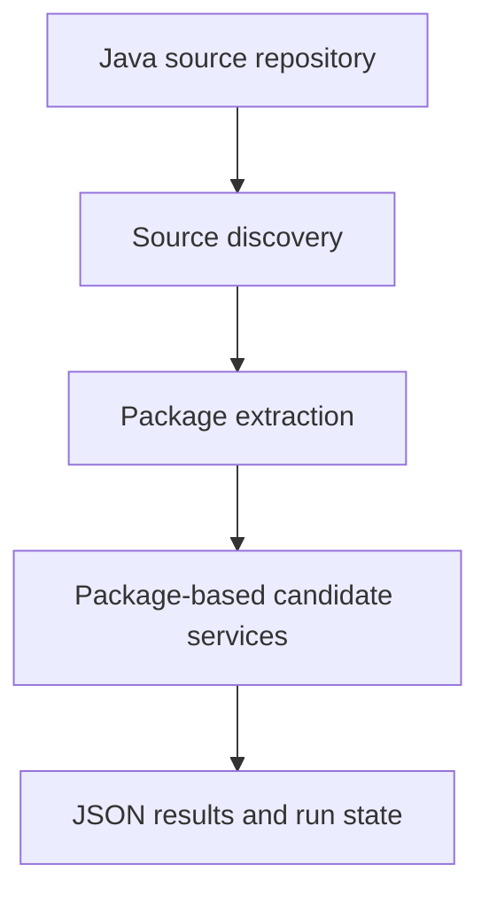

# TraceMicro

Agentic analysis framework for monolith-to-microservices decomposition.

## Phase 1 implementation

The current implementation provides a preliminary, non-agentic,
package-based baseline for Java applications.

It reads Java source files, extracts package declarations, groups files
into candidate services, and exports structured JSON results.

## Architecture

The proposed agentic architecture is documented in the Phase B proposal.
It has not yet been implemented.

## Data source

Spring PetClinic:
https://github.com/spring-projects/spring-petclinic

Source revision: REPLACE_WITH_ACTUAL_COMMIT_ID
Download date: REPLACE_WITH_ACTUAL_DATE

Input: src/main/java/**/*.java
Unit of analysis: Java source file.

## Requirements

Python 3. No external Python packages are required.

## Run

Download and extract Spring PetClinic, then run:

python baseline.py "/path/to/spring-petclinic"

Output: results/baseline_result.json

## Initial evaluation

The initial evaluation input is the recorded Spring PetClinic snapshot.

Reported measures:
- Number of eligible Java files.
- Number of assigned files.
- Assignment coverage.
- Number of package-based candidate services.
- Unassigned files.

The actual initial results are stored in results/baseline_result.json.
These are pipeline and coverage measures, not architectural accuracy.

## Structured output contract

- baseline: name of the implemented method.
- unit: unit of analysis.
- state: completion status and coverage counts.
- source_inventory: discovered source-file paths.
- candidate_services: package names mapped to source-file lists.
- limitations: known implementation limitations.

## Current limitations

Package structure may not correspond to business service boundaries.
The baseline does not analyze dependencies, runtime behavior, or data
ownership. No reference decomposition has been evaluated.

## Remaining work

- Graph-clustering baseline.
- Model provider configuration and real model invocation.
- Agent tool interfaces.
- Targeted evidence collection.
- Independent verification.
- Budget-aware orchestration.
- Reference annotations and decomposition-quality evaluation.****
