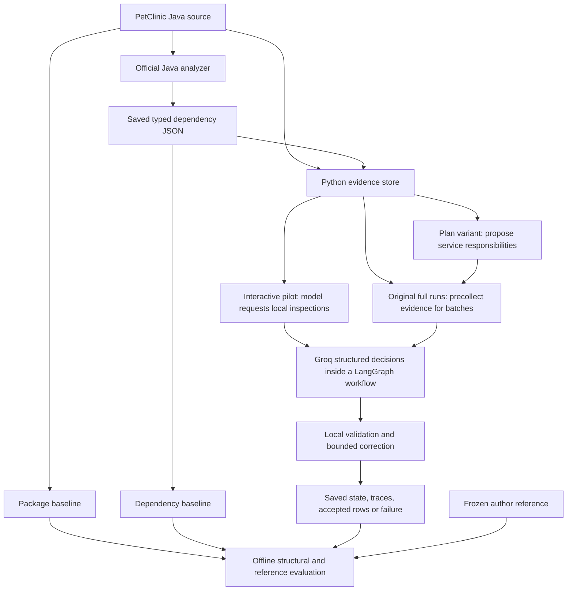

# TraceMicro project guide and viva preparation

**The result to remember.** TraceMicro turned Java source and saved static dependencies into inspectable class assignments. Three full-scope live runs each assigned all 25 PetClinic classes to one group. The package baseline agreed with all domain pairs in the approved author reference, and every scored method missed the annotated sharing. A plan-guided attempt accepted a service plan and then failed on its first assignment request. This is a PetClinic development case study with operational and reference-agreement evidence. [Final manuscript](../Paper/reviewed_v4/corrected_manuscript.md) · [Final evaluation](../results/final_day_20261127/author_evaluation_20261127/README.md)

## 1. The research problem

A **monolith** is an application delivered as one deployable unit. It can still have clean internal modules. For example, a clinic application can handle owners, pets, visits and veterinarians in one deployment. **Microservices** are separately deployable services organized around responsibilities. A split can let teams change or scale one responsibility independently. It adds network calls, deployment work and cross-service data coordination.

**Decomposition** means deciding what should move together. A class might belong to a business feature, be reused by several features, or provide application-wide infrastructure. Package names give hints. Dependencies show relationships. Data ownership, transactions, runtime scenarios and business priorities also matter. Separating two classes that constantly work together may increase coordination. Keeping everything together avoids crossing edges while yielding a one-group proposal.

**MicroAgent** addresses the problem of using large language models to propose service boundaries from complex Java systems. The paper describes Domain, per-domain Clustering, optional Merging, Common Class and Review roles, with tailored context and specialized tools. In §3.2.4 the Review role also revisits assigned classes and resolves inconsistencies. Its published **89.2% weighted similarity** and **93.4% common-class F1** belong to the authors' benchmark. We ran the official static analyzer and did not execute their full model pipeline on a matched benchmark. [Base paper, especially §3.2.4 and Table 3](../results/stage_a_text/microagent.txt) · [Artifact provenance](../vendor/provenance.json)

**TraceMicro** was proposed to study three questions motivated by that approach. Can targeted evidence help when initial runtime evidence is incomplete? Can separately assessed verification catch poor recommendations? Can selective coordination preserve quality while consuming fewer resources? The implemented case study focused on building and measuring an evidence-linked workflow under bounded requests. It recommends class memberships and records its decisions. Migration, deployment and production performance are outside the demonstrated work. [Approved proposal, §§3 and 11–12](../results/stage_a_text/phase_b_compact.txt)

## 2. The three approved research gaps

### G1. Reliability when architectural evidence is incomplete

- **Problem and proposal.** A trace only covers operations that were exercised. We proposed hiding complete runtime scenarios at 100%, 50% and 0% initial availability, then letting an investigator request targeted execution or data-access evidence for disputed assignments. The proposed target at 50% initial availability was an absolute gain of at least 0.05 mean domain-pair F1 within matched budgets.
- **Implemented and tested.** Source records flag partial excerpts. `ScenarioEvidence` deterministically masks whole scenarios and counts permitted recovery attempts, including unsuccessful lookups. A four-scenario synthetic exercise tested masking and one recovery per condition. The live PetClinic workflow used source and static graph evidence.
- **Conclusion and remaining work.** The mask and accounting logic worked on the synthetic inputs. Real instrumentation, measured application and database traces, investigator integration and matched quality comparisons remain incomplete. The experiment gives no measured robustness gain from recovering runtime evidence. [Mask implementation](../tracemicro/runtime_evidence.py) · [Synthetic result](../results/course_development_20261123_2201/synthetic_trace_masks.json)

### G2. Independent verification of decomposition recommendations

- **Problem and proposal.** A plausible assignment or valid JSON can still place a class poorly. The proposal combined deterministic consistency checks with a separate evidence-based critic and an independently prepared assessment. The intended target was at least 20% relative reduction in independently identified assignment errors with no more than two percentage points of coverage loss.
- **Implemented and tested.** The assignment validator checks scope, membership, sharing and evidence references. The optional advisory critic sees compressed evidence and saved assignments without generator dialogue or reference labels. Its findings and proposals are checked and saved. It leaves the original assignments intact. Injected transport tested critic success and failure, and the final offline evaluator scored completed outputs against the approved author reference.
- **Conclusion and remaining work.** We can find structural errors and document agreement with an AI-assisted, model-exposed author. Live critic effectiveness, independent adjudication, a correction acceptance procedure and measured error reduction remain incomplete. For example, the cap2048 plan passed citation-ID checks while its infrastructure proposal cited declarations of `Pet` and `PetController`. [Validator](../tracemicro/workflow.py) · [Advisory critic](../petclinic_critic.py) · [Cap2048 citation diagnosis](../results/final_day_20261127/comparison_cap2048/diagnosis.md)

### G3. Quality–cost trade-offs in agent coordination

- **Problem and proposal.** More model calls may add cost and delay. We proposed investigating unresolved cases selectively and comparing with fixed coordination under the same capabilities. The intended target was at least 20% lower median tokens with at most 0.02 loss in mean pairwise F1.
- **Implemented and tested.** Request ledgers enforce caps, pacing and pre-request deadlines. The critic has off, fixed and selective modes. Fixed invokes once. Selective invokes when local findings exist or the output has fewer than two nonempty groups. A synthetic two-group case exercised the skip branch. Offline routing on all three original one-group outputs selected criticism in both fixed and selective modes.
- **Conclusion and remaining work.** Budgets and routing are executable and logged. The rule showed no predicted call savings on those original outputs. A matched live comparison of total generator and critic usage and independently assessed quality remains incomplete. The proposal also discussed caching and repetition detection. The demonstrated original workflow precollects evidence and carries accepted assignments forward. [Budget implementation](../petclinic_batch_groq.py) · [Routing replay](../results/course_development_20261123_2201/routing_on_originals.json) · [Gap experiment notes](DEVELOPMENT_EXPERIMENTS_20261123.md)

## 3. The dataset

**Spring PetClinic** is a Java Spring sample application for clinic operations. The checked-in development snapshot is a Java-source subset. It contains 30 Java files. The five `package-info.java` files describe packages and are excluded, leaving 25 class or interface identifiers. The inventory uses the declared package plus the filename stem. It is a snapshot-specific scope rule. The eligible-source SHA-256 identifies our copy, and the upstream commit and acquisition date are unknown. JPetStore and AcmeAir were held out from development and were not evaluated. [Source provenance](../sample_petclinic/PROVENANCE.md) · [Inventory code](../baseline.py)

| Package | Eligible IDs | What they cover |
|---|---:|---|
| `owner` | 11 | Owners, pets, pet types and visits, including web handling, persistence and input validation |
| `vet` | 5 | Vets, specialties, persistence, a web controller and a response wrapper |
| `system` | 4 | Caching, web configuration, welcome and error demonstration |
| `model` | 3 | BaseEntity, NamedEntity and Person |
| Root | 2 | Application startup and native-image runtime hints |

An **entity** represents persisted application data, such as `Owner`, `Pet` or `Visit`. A **controller** receives web requests and coordinates work, such as `OwnerController` handling owner requests. A **repository** describes persistence operations, such as `OwnerRepository.findById`. A **validator** checks inputs, such as `PetValidator` checking fields of a pet. Configuration classes and shared base classes serve different roles from business entities.

The **author-reviewed development reference** has 16 domain decisions (11 owner and 5 veterinary), 3 shared decisions (BaseEntity, NamedEntity and Person), and 6 infrastructure decisions. It has no uncertain or excluded decisions. The author approved the worksheet with ChatGPT assistance after exposure to model outputs. The approved draft was frozen byte for byte before scoring. Its receipt supersedes the pending text inside the draft. Shared means a logical association with multiple services. It does not choose a deployment strategy. [Frozen CSV and receipt](../results/final_day_20261127/author_evaluation_20261127/README.md)

## 4. Deterministic baselines and the analyzer

| Component | What it does | Observed result |
|---|---|---|
| Package baseline | `baseline.py` groups by declared Java package. No model is involved. | Five groups of 11/5/4/3/2 |
| Official MicroAgent analyzer | The official Java/JavaParser component extracts typed static relationships and writes a JSON graph. Inverse entries such as `EXTENDED_BY` describe the reverse view of an existing edge. | 25 nodes, 59 direct typed records, 42 distinct directed endpoint pairs |
| Dependency baseline | `dependency_baseline.py` converts direct records to simple undirected links for clustering. It starts with single-class groups and merges the pair with the highest fraction of possible cross links present. Ties follow a fixed lexical order. | Fixed `k=5` gives 21/1/1/1/1, with four system singleton groups and two zero-link merges |

For example, `Owner → Pet` appears as `ASSOCIATES`, `CALLS` and `USES`. Those are three typed records for one ordered pair. `Pet → Owner`, if present, would be a different directed pair. The saved graph reports 181 static occurrences. They are analyzer counts, with no measured runtime invocation frequency. A hand-checkable four-class fixture produced the two expected inheritance edges and their inverse records. A limitation probe showed an invalid file could be omitted and an unresolved field type could lack a diagnostic. The graph also lacks source-line locations for individual edges. [Analyzer provenance and checks](DEPENDENCY_BASELINE_REVIEW.md) · [Graph JSON](../results/dependency_baseline/petclinic_raw.json) · [Clustering code](../dependency_baseline.py)

**Why crossings alone are insufficient.** The package split has 14/59 typed and 14/42 pair crossings. The dependency split and each original model output have 0/59 and 0/42. The dependency result still puts 21 classes together, and a single group makes crossing impossible by definition. Neither metric measures business cohesiveness, data ownership, latency or whether shared classes were recognized.

## 5. Architecture from source to result



| Piece | Role in this project |
|---|---|
| Java and JavaParser | Java is the input language. The official analyzer parses source and emits the static graph. |
| Python | Handles inventory, evidence retrieval, runner logic, local checks, budgets, logs and evaluation. |
| LangGraph | Runs the configured graph of decision, inspection, validation and finish nodes. It orchestrates the workflow. |
| Groq and the LLM | Groq hosts the model, recorded as `openai/gpt-oss-20b` in the main runs. The model selects an action or proposes memberships. There was no model training. |
| Structured outputs | A strict JSON Schema requests an `action` envelope and typed fields. The provider can reject generation. Python separately checks application-specific rules and cites exact evidence IDs. |

**State** records the scope, permitted labels, remaining decisions/tools/revisions, evidence, previous candidate, findings and stop reason. In the interactive path, the model may ask for `inspect_source` or `inspect_dependencies`, or submit. Python dispatches the tool locally. A source result holds a bounded excerpt, path, lines and hash. A dependency result has graph provenance and incoming/outgoing records. The tool result gets an ID such as E3 and becomes available in the next prompt. These tools are JSON actions interpreted by local code. [Evidence store](../tracemicro/evidence.py) · [State and validation](../tracemicro/workflow.py) · [Graph nodes](../tracemicro/langgraph_workflow.py) · [Provider adapter](../tracemicro/providers.py) · [Schema](../tracemicro/action_schema.py)

**Batching.** The original full-scope path precollects two records for each class, **50 local reads**. Source excerpts use up to the first 80 lines, and six files are partial. Sorted identifiers form eight batches of three and one batch of one. Each prompt carries local evidence, allowed labels and previously accepted assignments. The model can submit only. Each batch allows two decisions and one correction after local findings. A provider error can terminate the batch before correction. A shared class has one row, multiple distinct labels, and `shared=true`. Local validation checks exact class coverage, duplicate and unknown classes or labels, that flag, and both same-class source and dependency citations. Accepted batches are combined and checked over the full universe. The request ledger enforces pacing and counts failures, including attempts with unknown usage. [Precollection and batching](../petclinic_batch_prototype.py) · [Live batch runner](../petclinic_batch_groq.py)

**Global planner.** The plan variant adds one model call over all 25 classes. Compact planning sees declaration anchors and outgoing typed dependency summaries. It proposes one to five labels with responsibilities and evidence IDs. The bounded version allows at most 160 characters per responsibility and one or two distinct citations. Assignment prompts receive the plan, retain the normal local evidence and omit the original concrete assignment example. There is no requirement to fill five groups. The cap2048 condition changes only the planner's completion allowance from 1,024 to 2,048. Assignment requests remain at 1,024. Plan validation checks schema, allowed unique labels, responsibility length and reference IDs. Semantic support needs separate assessment. [Global plan code](../petclinic_global_plan.py) · [Frozen cap2048 configuration](../configs/petclinic_global_plan_compact_v3_cap2048.json)

**What is agentic.** In the interactive run, the model chooses the next evidence request and uses the result to decide what to do next. In the original batch path, the model chooses assignments and can revise after findings. In the plan variant, it also proposes responsibilities. Source extraction, precollection, clustering, tool execution, validation, budgets and evaluation are deterministic. The optional critic is a separate model role tested with fixtures. The live full-scope original is a bounded workflow with model decisions.

## 6. A real Owner trace, step by step

Use the **live interactive LangGraph pilot** to show model-selected tool execution. It covers BaseEntity, Owner and Vet. The saved events record observable inputs, actions and outcomes. [Successful pilot trace](../results/groq_live/langgraph_pilot_1.json) · [Owner.java, around lines 48–50](../sample_petclinic/src/main/java/org/springframework/samples/petclinic/owner/Owner.java#L48)

| Step | What the saved trace shows |
|---|---|
| 1. Source and graph exist | `Owner.java` is the source input. The analyzer already produced the dependency JSON. The model does not run the Java analyzer during its tool action. |
| 2. Prompt before reading Owner | Event 13 is `decision_requested`. The prompt state already contains BaseEntity evidence E1 and E2. It lists the scoped class identifiers, permitted labels, allowed actions and evidence progress. |
| 3. Source action and tool | Event 14 selects `inspect_source` for Owner. The LangGraph inspection node calls `EvidenceStore.inspect_source`. Event 16 records E3, lines 1–80. Line 48 contains `@Entity` and line 50 declares `Owner extends Person`. |
| 4. Dependency action and tool | Event 18 requests another decision with E3 present. Event 19 selects `inspect_dependencies` for Owner. Event 21 adds E4. It includes Owner extending Person, Owner associated with Pet, and OwnerRepository persisting Owner. The dependency record points to the saved graph. |
| 5. State and submission | After the Vet tools run, event 33 gives the model E1–E6. Event 34 submits three class rows. Owner uses only `owners_candidate`, with `shared=false` and E3/E4. Vet uses `vets_candidate`. BaseEntity lists both. |
| 6. Validation and stop | The submission node calls `validate_output`. Event 36 records an empty findings list. The trace stops with `basic_checks_passed`. Owner's row passed the scope, label, sharing and same-class citation checks. |

**Contrast with the full run during the demo.** In the first complete original run, batch 2 uses precollected E11/E12 for Owner. The batch prompt already includes three earlier `candidate_1` assignments, the model submits `candidate_1` for Owner, and local validation passes. The different labels reflect different run conditions. The logs show what the model received, and the cause of its label choice was not isolated. [Original batch 2](../results/submit_only_live_20261122_1827/attempt_1/batch_02.json) · [Full precollection](../results/submit_only_live_20261122_1827/attempt_1/precollection.json)

## 7. Experiment chronology and lessons

| Stage and evidence type | What happened | What it taught us |
|---|---|---|
| Package reproduction and analyzer verification, deterministic | Package memberships reproduced. The Java analyzer ran on PetClinic and on the inheritance and diagnostic fixtures. The graph-based grouping produced 21/1/1/1/1. | Baselines are rerunnable. An analyzer can exit successfully with incomplete diagnostics. |
| 17 Nov small live checks | Two one-class smoke runs failed on invalid action shape. The third passed. The first three-class pilot hit HTTP 429. Two paced pilots hit HTTP 400, with a saved `json_validate_failed` diagnostic for the second. A structured pilot exhausted its revision budget. The progress-aware Python pilot completed all three classes. | Connection, action parsing, provider schema acceptance and local completeness are separate stages. Pacing did not eliminate all failures. [Live register](EXPERIMENT_REGISTER.csv) |
| 21 Nov live LangGraph pilot | Seven requests, six local inspections, 24,401 tokens, three classes accepted. Owner and Vet were separated and BaseEntity was assigned to both. | Shows real tool selection and shared output at limited scope. The full run used different context and labels. [Live trace](../results/groq_live/langgraph_pilot_1.json) |
| Full-scope batch prototype and transport fixtures, synthetic | Artificial assignments exercised nine batches, coverage, sharing, correction and stop paths. | Checks assembly and validation plumbing. Artificial mappings never count as model discoveries. [Prototype](../petclinic_batch_prototype.py) |
| Earlier full-scope live attempts | The first exhausted correction on invalid service labels, accepting 0/25. Two others accepted 3/25 before batch 2 HTTP 400. A separate attempt received no HTTP response and accepted 0/25. | Allowed labels, provider reliability and partial coverage need separate accounting. [Reliability export](../results/final_day_20261127/author_evaluation_20261127/evaluation/reliability.csv) |
| Three complete original live runs | All 25 classes assigned exclusively to `candidate_1` on every run. All 27 batches passed on first submission. The three runs used 27 requests and 144,478 reported tokens. | Full completion and exact membership agreement can coexist with an uninformative split. The concrete prompt example, previous assignments and other inputs were not independently varied. [Original full-scope comparison](../results/final_day_20261127/comparison_cap2048/comparison.csv) |
| Full planner v1 and compact v2, live failures | v1 sent 139,972 bytes and received HTTP 413 with `rate_limit_exceeded`. Compact v2 sent 9,464 bytes and received HTTP 400 with `json_validate_failed` and empty rejected generation. Both stopped before assignments. | Smaller context reduced bytes. The recorded v2 diagnostic leaves its underlying cause unresolved. [Failure evidence](../results/final_day_20261127/comparison_cap2048/resources.csv) |
| Reduced-context planning probe, live diagnostic | One class and two evidence records. One request used 1,358 tokens and passed plan checks. No assignment stage followed. | Shows that this reduced request could pass. It does not establish full-scope feasibility. [Probe](../results/final_day_20261127/saved/reduced_probe/probe.json) |
| Scenario masks, critic and routing, synthetic or replayed | Artificial scenarios tested masking/recovery. Injected responses tested advisory criticism. The stored original outputs triggered fixed and selective routing alike. | Implementation coverage without demonstrated runtime robustness, verification gain or live savings. [Gap experiment records](DEVELOPMENT_EXPERIMENTS_20261123.md) |
| Compact v3 readiness, synthetic | Injected responses completed the full planner and batches with 25 artificial accepted classes. | The code path worked with supplied valid outputs. [Synthetic summary](../results/restart_readiness_20261124_0715/simulated_single/summary.json) |
| 27 Nov compact v3, live | Planning ended with `finish_reason=length` at 1,024 completion tokens. One request used 3,464 tokens and accepted 0/25. | This failure was observed before any action parse or local plan validation. [Plan trace](../results/final_day_20261127/live_v3/run_1/planning.json) |
| 27 Nov cap2048, live | An earlier continuation stopped at time preflight with no new call. A separately authorized attempt accepted five proposed responsibilities with `finish_reason=stop`. Batch 1 received HTTP 400 `json_validate_failed` with empty rejected generation and no finish reason or reported usage. The run accepted 0/25. | Planning completed once under the higher allowance. A provider rejection stopped assignment. Five responsibilities remain proposed labels without realized group memberships. [Diagnosis and citations](../results/final_day_20261127/comparison_cap2048/diagnosis.md) |
| Release checks and final author evaluation, offline | The recorded full suite passed 142 tests. The final evaluation reproduced eight exports byte for byte. Its reliability table retains three completed and eight failed full-scope runs, three completed and six failed limited-scope runs, and one reduced probe. | Reproduction from artifacts and software verification are separate from fresh inference and independent architectural assessment. Counts span different configurations. [Final evaluation](../results/final_day_20261127/author_evaluation_20261127/README.md) |

## 8. What the metrics mean

### Small examples to explain first

| Metric | Example |
|---|---|
| Coverage | If 3 of 4 scoped classes have accepted rows, coverage is 75%. It says how much output exists. |
| Pairwise precision, recall and F1 | The reference groups A/B and C/D, so AB and CD are positive pairs. A prediction grouping A/B/C and D gives AB, AC and BC. It has one true positive, two false positives and one false negative. Precision is 1/3, recall is 1/2 and F1 is 0.4. F1 combines precision and recall as 2TP/(2TP+FP+FN). |
| Shared-class identification | If S and T are annotated shared and the method flags S and U, precision and recall are both 1/2. The anchor variant asks which shared-class/domain-class links are recovered. A shared S with memberships in the services of domain classes A and B gives anchors S–A and S–B. Predicting only S–A recovers 1 of 2 anchors. |
| Cross-group dependencies | Suppose A uses B and A calls B, while B uses C. Put A and B together and C elsewhere. One of three typed records crosses, and one of two directed endpoint pairs crosses. A shared class and its neighbor are in the same group for this metric whenever their memberships overlap. Edges with unassigned endpoints are outside the covered-edge denominator. |
| Requests, tokens and time | Suppose a run sends two requests. One reports 90 prompt and 30 completion tokens, and the other fails without usage. The run has two attempts, 120 known tokens and one unknown-usage attempt. If elapsed time is 64 seconds with 60 seconds paced, most of the time was enforced waiting. The total includes workflow overhead and service time. |

### The actual evaluation

The evaluator compares co-memberships among 16 reference **domain** classes, with service names ignored. Of 120 possible unordered domain pairs, 65 are positive in the reference. A model row marked shared among reference domain classes contributes no positive domain links. Infrastructure contributes to coverage and shared detection. Shared identification and shared-to-domain anchor association are separate metrics. The frozen reference has no uncertain/excluded cases. [Evaluator](../tracemicro/evaluation.py) · [Verified counts and scores](../results/final_day_20261127/author_evaluation_20261127/evaluation/agreement.csv)

| Method | Coverage | Domain TP / FP / FN | Precision / recall / F1 | Typed crossings | Directed-pair crossings |
|---|---:|---:|---:|---:|---:|
| Package | 25/25 | 65 / 0 / 0 | 1.000 / 1.000 / 1.000 | 14/59 | 14/42 |
| Dependency | 25/25 | 65 / 55 / 0 | 0.542 / 1.000 / 0.703 | 0/59 | 0/42 |
| Each of the three originals | 25/25 | 65 / 55 / 0 | 0.542 / 1.000 / 0.703 | 0/59 | 0/42 |

The dependency baseline and original runs group all reference domain classes together, producing every possible pair. Recall is 1 because the true pairs are all included. Precision falls because the 55 between-domain pairs are also included. The package score reaches 1 because the author domain assignments align with the owner and veterinary packages. All five methods identify **0 of 3 shared classes** and **0 of 48 shared-to-domain associations**. Those metrics have recall and F1 of zero and undefined precision because no positives were predicted. Agreement with the development reference does not establish independent quality or a deployment recommendation.

| Live condition | Requests | Known tokens | Pacing | Elapsed |
|---|---:|---:|---:|---:|
| Original run 1 | 9 | 47,837 | 479.799 s | 491.156 s |
| Original run 2 | 9 | 48,077 | 479.859 s | 492.797 s |
| Original run 3 | 9 | 48,564 | 539.109 s | 550.485 s |
| Compact v3 failure | 1 | 3,464 | 0 s | 2.016 s |
| Cap2048 failure | 2 | 3,505 from planning, batch usage unknown | 59.438 s | 63.547 s |

The original totals support a description of those runs. The failed plan variants stopped at different stages, so their smaller token totals are not complete workflow savings. No billed cost was recorded. Failed runs appear in the reliability table and are outside agreement scoring. [Resources and stage diagnostics](../results/final_day_20261127/comparison_cap2048/resources.csv)

## 9. Reproduce and demonstrate from the repository

Use the final release files listed in the [synchronization manifest](FINAL_EVALUATION_GITHUB_SYNC.csv). Keep original artifact paths and bytes, including the frozen receipt and historical run records. The recorded runtime used Windows, Python 3.10.11 and LangGraph 0.6.11. From the repository root in PowerShell, set up a project-local environment if needed.

```powershell
py -3.10 -m venv .venv-langgraph
.\.venv-langgraph\Scripts\python.exe -m pip install -r requirements.txt
$py = '.\.venv-langgraph\Scripts\python.exe'
```

The install may need package access. The saved-graph evaluation needs neither Java nor a provider key. Use fresh output names for each invocation.

```powershell
$out = 'results/viva_' + [guid]::NewGuid().ToString('N')
& $py -B -X utf8 petclinic_author_evaluation.py --output-dir $out
Import-Csv (Join-Path $out 'agreement.csv') | Format-Table -AutoSize
```

Expect five scored outputs, 25 approved decisions and 21 reliability or diagnostic records. The program verifies the approved reference SHA-256 and the recorded trace hashes. It recomputes structural results, adapts both deterministic membership lists and evaluates them with the three saved accepted model outputs. `agreement.json`, `agreement.csv`, `reliability.csv` and the `structural/` exports are the evidence to show. No sockets are used by this evaluator. [Exact reproduction notes](../results/final_day_20261127/author_evaluation_20261127/README.md)

To run just the two baselines or demonstrate a fixture workflow, use fresh paths and the same environment.

```powershell
& $py -B -X utf8 baseline.py sample_petclinic --compare results/original_baseline_result.json --output results/viva_package.json
& $py -B -X utf8 dependency_baseline.py results/dependency_baseline/petclinic_raw.json sample_petclinic --services 5 --output results/viva_dependency.json
& $py -B -X utf8 petclinic_batch_prototype.py --output-dir results/viva_fixture
```

The fixture command uses artificial assignments. For the staged software checks use `tools/verify_release_offline.py` with Python `-I -B -X utf8` and a new `verification_outputs/` subdirectory. To regenerate the Java graph separately, the analyzer build and JDK are prerequisites. See the recorded wrapper and command in the analyzer review. For a future separately authorized fresh model execution, the original live runner accepts explicit model, request, pacing and wall-time limits with a new ledger. Saved scores require replay of the stored outputs even if a future run produces different assignments. The viva demo uses saved outputs. [Release checks and original CLI](../release_candidates/tracemicro_20261126_0519/README.md) · [Analyzer rerun details](DEPENDENCY_BASELINE_REVIEW.md) · [Session runner](../petclinic_live_session.py)

## 10. What you can defend as a contribution

| Demonstrated | Proposed or incomplete |
|---|---|
| Reproducible PetClinic package and dependency baselines with explicit source and graph identities. | A broader comparison across pinned, runnable applications and held-out scenarios. |
| A traceable live tool-using pilot and a repeatably complete original 25-class workflow. | Real runtime and database evidence collection and robustness under controlled evidence loss. |
| Evidence-linked structural checks, safe failure diagnostics, sharing representation and bounded resource accounting. | Independent validity of decomposition and independently verified error reduction. |
| A documented compact planning length failure and later plan acceptance followed by assignment rejection. | Full live feasibility of the plan-guided variant and a causal explanation for the provider's rejected assignment. |
| Offline author-reference agreement with explicit AI assistance and model exposure, plus a complete failure ledger for the registered cases. | Matched MicroAgent comparison, measured quality–cost trade-offs, deployment and gains on G1–G3. |

If asked for the main result, lead with both observations. The system reliably produced structurally valid complete output in the three original runs. That output always grouped all classes together and missed sharing in the author reference. The result exposed the limits of coverage, citation-ID checks and static crossings as measures of decomposition quality.

## 11. Presentation and viva

### 30-second introduction

> TraceMicro proposes how to group Java classes into candidate microservices and records the evidence behind each assignment. We tested it on 25 Spring PetClinic classes. Three live runs covered every class but placed them all in one group. Against our disclosed AI-assisted author reference, the package baseline agreed better on domain pairs, and every scored method missed the annotated sharing. The project shows why we need to evaluate both workflow completion and the quality of the proposed split.

### Two-minute architecture explanation

- **0:00–0:30.** Start with the Java snapshot. The official MicroAgent analyzer produces a typed static graph. Python loads that graph and the source into an evidence store. The package baseline reads package declarations. The dependency baseline clusters graph links into five groups.
- **0:30–1:00.** Explain the interactive path using Owner. Groq's hosted model returns a structured action. LangGraph routes the action to a Python inspection node. The tool saves a source excerpt or graph record with an ID, and the next prompt includes it.
- **1:00–1:30.** Explain the full-scope path. Python precollects two records per class and handles nine batches. The model submits rows. Python checks class coverage, permitted labels, the shared flag and same-class evidence, then records success or a bounded correction or failure. The ledger counts every transport attempt and pacing wait.
- **1:30–2:00.** Explain the optional plan stage and results. A planner proposes responsibilities before assignment. The cap2048 run produced a plan and stopped on batch 1. The offline evaluator scores complete groupings against the frozen author reference and keeps failures in a separate reliability export.

### Five-minute offline demonstration

Prepare the repository and Python environment before the presentation. Keep the code editor, trace and CSV views open so time is spent explaining the outputs.

| Time | Show | Say |
|---|---|---|
| 0:00–0:40 | `Owner.java`, then the Owner record in `petclinic_raw.json` | “The Java source gives an entity and inheritance declaration. The graph gives separate static relationships. A record's type and direction matter.” |
| 0:40–1:55 | `langgraph_pilot_1.json`, events 13–21, then 33–36 | “The model selects two local inspections for Owner. The results become E3 and E4 in state. The final Owner row cites both and passes the local rules.” |
| 1:55–2:45 | Original `batch_02.json` and the 25-class memberships | “Batch evidence is precollected here. Owner is assigned to `candidate_1`, and all three original runs produce the same single group.” |
| 2:45–3:50 | Run the offline evaluation command in Section 9. Open `agreement.csv`. | “We replay the complete saved outputs and recompute the baselines. Domain-pair F1 is 1.000 for packages and 0.703 for the dependency baseline and originals. All five miss sharing.” |
| 3:50–5:00 | `reliability.csv`, cap2048 diagnosis and approval receipt | “Planning passed, then the provider rejected the first assignment. Its usage is unknown. The reference is author-approved with ChatGPT assistance and prior model exposure. Independent improvement remains open.” |

If the terminal demo stalls, open the already verified exports and disclose that you are showing a saved reproduction. [Saved agreement](../results/final_day_20261127/author_evaluation_20261127/evaluation/agreement.csv) · [Saved reliability](../results/final_day_20261127/author_evaluation_20261127/evaluation/reliability.csv)

### 25 likely instructor questions

1. **What research problem are you solving?** Recommending which Java classes could belong together as service candidates and giving traceable evidence for those recommendations. Deploying the services is separate work.
2. **What practical distinction matters between a monolith and microservices?** A monolith deploys as one unit. Microservices can be deployed separately, so boundaries affect data ownership, network calls and coordination.
3. **Why is grouping by package a useful baseline?** It is cheap, deterministic and gives a simple test of whether a richer method adds anything beyond source organization.
4. **What does MicroAgent do?** It uses specialized model roles and context to identify domains, cluster or merge classes, handle shared classes and refine the decomposition.
5. **What did you reuse from MicroAgent?** We reused and ran its official Java static analyzer. Our Python grouping, prompting, bounded orchestration and evaluation are separate. We did not run its full agent pipeline in a matched comparison.
6. **What can you claim for G1?** Scenario masking and counted recovery worked on synthetic records. No experiment used measured runtime scenarios to establish a quality gain under evidence loss.
7. **What can you claim for G2?** Structural checks and an advisory critic were implemented. We measured agreement with the approved author reference. Independent adjudication and verified error reduction remain open.
8. **What can you claim for G3?** Budgets and routing were exercised. Fixed and selective both choose criticism on all three originals, so those outputs show no predicted critic-call savings. A matched live cost and quality experiment remains open.
9. **Where is the agentic behavior?** In the pilot the model selects tools based on the current state. In the batch runs it proposes and can revise assignments. Python executes the tools and applies deterministic rules.
10. **Why use LangGraph?** It organizes observable decision, tool, validation and termination nodes. The model supplies decisions and the graph controls where those decisions go.
11. **What is a structured output?** It is a response requested in a machine-readable shape described by JSON Schema. The provider can reject a generation, and local checks still verify application-specific constraints.
12. **What does an evidence ID prove?** It proves that a reference resolves to a recorded item when validation passes. The item still needs to support the specific claim. The planner's infrastructure citations illustrate this distinction.
13. **Why exactly 25 classes?** The fixed Java-source subset has 30 Java files. We exclude the five package-description files and use the remaining fully qualified identifiers as scope.
14. **What is the difference between 59 and 42?** The first count distinguishes relationship types on the same ordered endpoints. The second collapses those types while retaining direction.
15. **How can a group with 21 classes have zero crossing dependencies?** All 59 recorded edges have both endpoints in the 21-class group. The other four groups are singletons. This gives zero crossings in the saved graph and little separation of business responsibilities.
16. **Why did you use batches?** Batches bound how much local source and relation evidence each call receives. Carrying earlier outputs can support consistent labels and may also reinforce earlier choices. The experiment did not isolate that effect.
17. **Why did all three original runs select one group?** The cause was not isolated. The prompt example, neutral labels, context and previously accepted assignments are plausible factors. The local contract permits one group.
18. **What distinguishes compact v3 from cap2048?** The planning completion allowance increased from 1,024 to 2,048. v3 hit the length stop. Cap2048 finished planning and received HTTP 400 at assignment. The assignment allowance stayed at 1,024.
19. **What exactly caused the cap2048 failure?** The provider rejected batch 1 with `json_validate_failed`. Its rejected-generation field was empty. The client got no action to validate, so the underlying cause remains unknown.
20. **Why did the package baseline get F1 of 1?** The reference's 16 domain classes follow the owner and vet packages. All 65 reference-positive domain pairs match that package grouping. The package baseline still misses all annotated sharing.
21. **How can recall be 1 when a model gives only one service?** A single service predicts every possible domain pair. It gets all 65 true pairs and also predicts 55 false pairs, lowering precision and F1.
22. **Can you compare 0.703 with MicroAgent's 89.2%?** The values use different metrics, references and evaluated conditions. Our 0.703 is domain-pair F1 against this author reference. The published value is weighted similarity.
23. **Is the reference independent ground truth?** A single author approved it with ChatGPT assistance after seeing outputs. We disclose that and measure agreement. Independent annotation and adjudication remain future work.
24. **Why keep failed runs if they have no agreement score?** Dropping them would hide reliability and cost. The reliability table preserves accepted coverage, stage, attempt counts and known or unknown usage. Agreement uses complete runs for a common scoring scope.
25. **What would make the next study stronger?** Freeze independently adjudicated labels on pinned held-out applications, collect real scenarios, and run matched comparisons with the full MicroAgent pipeline, fixed/selective coordination and gap-specific ablations.

### Glossary

| Term | Plain meaning |
|---|---|
| Agent | A model-driven decision loop that can choose actions based on the current context. |
| Baseline | A comparison method used to judge what an added technique contributes. |
| Batch | A small fixed set of classes submitted together. |
| Cohesion | The degree to which parts inside one service contribute to related responsibilities. |
| Coupling | Dependencies or coordination required between components. |
| Deterministic | Produces the same output for the same fixed inputs and settings. |
| Directed edge | A relationship from an ordered source to a target. |
| Evidence record | A stored source excerpt or dependency lookup with an ID and provenance. |
| Fixture | A controlled example with known or artificial inputs used to test behavior. |
| Freeze | Save a fixed version and record its checksum before evaluation. |
| Held-out application | An application reserved for later evaluation and kept out of development tuning. |
| Inference | A model generating an answer from its input. |
| JSON Schema | A machine-readable definition of allowed response fields and types. |
| Pacing | Deliberate waiting between provider requests. |
| Provenance | Where a file, measurement or evidence item came from. |
| Replay | Reuse or reanalyse a saved result without requesting a new model response. |
| Runtime trace | Events observed when an application actually executes. |
| SHA-256 | A checksum used here to identify exact file bytes. |
| Shared membership | One class associated with more than one candidate service. |
| Static analysis | Inspection of code and relationships without executing the application. |
| Token | A unit of model text representation used for input and completion accounting. |
| Validation | Checking a result against stated rules before accepting it. |
